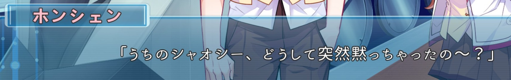
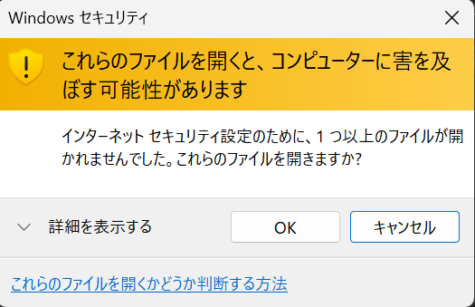
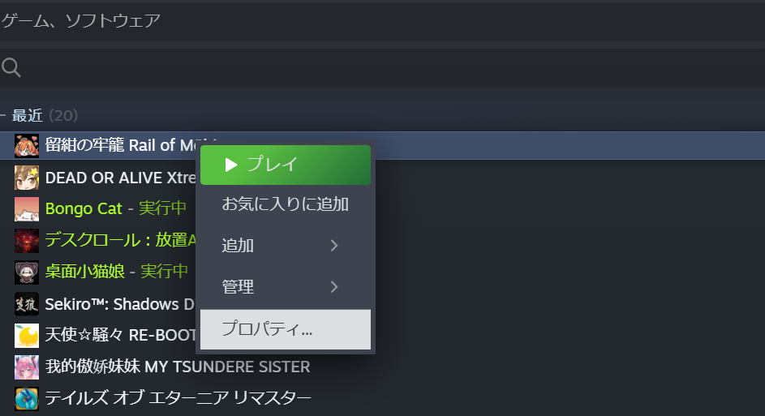
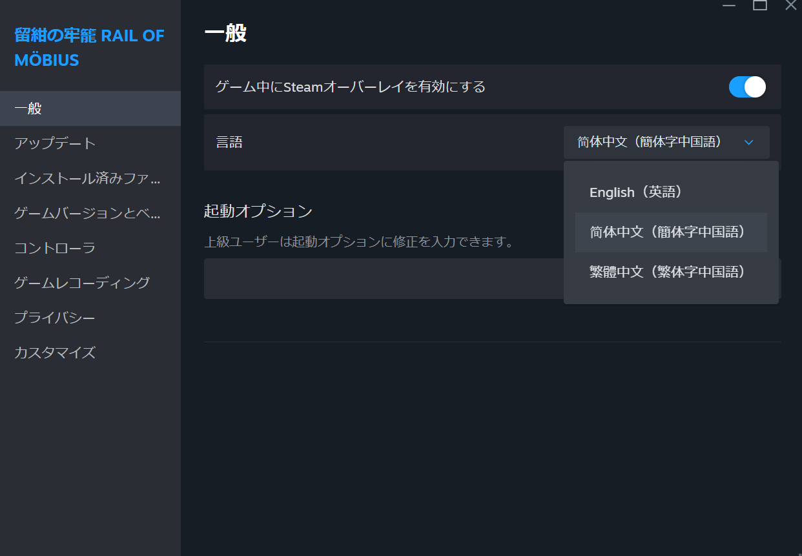
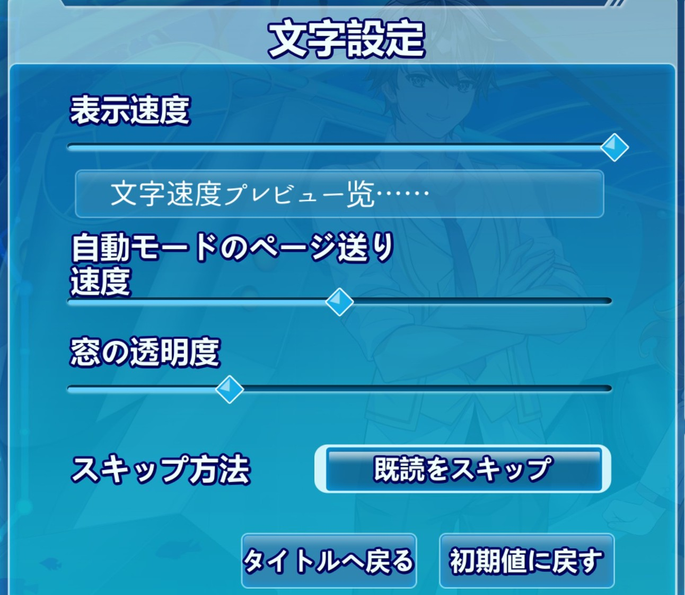

# 留紺の牢籠 Rail of Möbius 日本語化MOD

Steam 版 **『留紺の牢籠 Rail of Möbius』**（繁体字原名: 湛藍牢籠 ／ 簡体字: 湛蓝牢笼 ・ 開発/発行: PHOSEPO ・ AppID 1479500）の
**本文とUIを日本語で読めるようにする非公式MOD**です。

**下の「使い方」どおり、`導入ファイル` の中身をゲームフォルダに貼り付けるだけ**で適用できます。
追加ファイルだけで動き、**削除すれば完全に元に戻ります**。ゲーム本体のファイル（シナリオ・UI・フォント）は一切書き換えません。
実行中にメモリ上だけ差し替えます。

| 項目 | 内容 |
|---|---|
| 対応 | Steam 版『留紺の牢籠 Rail of Möbius』（確認ビルド buildid 13230446 / Unity 2018.2 Mono・64bit） |
| 導入 | `導入ファイル` の中身をゲームフォルダにコピーするだけ（1回貼り付けるだけ） |
| 実行基盤 | **BepInEx 5.4.22・UnityDoorstop を同梱済み** — 別途ダウンロードは不要 |
| Steam の言語 | **简体中文** に設定してください（English のままだと日本語が表示されません／手順1） |
| 元に戻す | 追加された `BepInEx`・`version.dll`・`doorstop_config.ini` を削除するだけ |
| セーブデータ | **影響なし**（導入状態・解除状態 both 実測済み） |
| 重さ | 合計 約2.3MB（MOD本体 約1.2MB ＋ 実行基盤 約1.1MB） |
| 版 | MOD v0.3.0（2026-11-18） |

適用すると、本文はこのように日本語で表示されます。



---

## ダウンロード

**方法1（かんたん）** — このページ右上の **`Code` → `Download ZIP`**（コード → ZIPでダウンロード）
→ 解凍すると `導入ファイル` フォルダが入っています。使い方は下のとおり、**その中身をゲームフォルダに貼るだけ**です。

**方法2（MOD本体だけ欲しい場合・既に BepInEx を使っている方）** — [`版0.3.0`](版0.3.0/) フォルダの3個
（[`MobiusJP.dll`](版0.3.0/MobiusJP.dll)・[`jp_grid.tsv`](版0.3.0/jp_grid.tsv)・[`jp_ui.tsv`](版0.3.0/jp_ui.tsv)）
を開いて、右上の **ダウンロードボタン**（Download raw file）を押す → ご自身の `BepInEx\plugins\` に置いてください。

> ZIP は GitHub が自動で作るものです。中身はこのページに並んでいるファイルと同じです。

### ZIP を開くときの警告について

Windows では、ダウンロードした ZIP を開くときに次の警告が出ることがあります。



これは**インターネットからダウンロードしたファイルに Windows が付ける印**によるもので、
中身が危険という意味ではありません。本MODの中身は **テキストの表2個と、小さな DLL 群だけ**で、
インストーラ形式のプログラムは入っていません（DLL もテキスト表も、そのまま目視・確認できます）。

- そのまま **「OK」** を押して解凍して構いません。一度解凍すれば、そのあとは警告は出ません。

---

## 使い方（4ステップ）

### 1. Steam の言語を **简体中文** にする

Steam ライブラリで『留紺の牢籠 Rail of Möbius』を右クリック → **プロパティ** → **一般** → **言語** を **简体中文** に変更します。





> ⚠ **このMODは简体中文のゲームデータに日本語を差し込みます。Steam の言語が English のままだと日本語が表示されません。**
> 言語を変更するとゲームデータの再ダウンロードが入ることがあります（数分かかることがあります）。

### 2. ゲームのフォルダを開く

Steam ライブラリで『留紺の牢籠 Rail of Möbius』を右クリック → **管理** → **ローカルファイルを閲覧**
（`RailOfMobius.exe` がある場所です）

### 3. `導入ファイル` の中身を、そこに貼り付ける

ZIPを解凍し、**`導入ファイル` フォルダの中身を開いて、入っている3つをそのままゲームフォルダに貼り付けてください**
（`導入ファイル` フォルダ自体ではなく、**中身**をコピーします）。

```
導入ファイル\
 ├─ BepInEx\
 │   ├─ core\      … 実行基盤（同梱済み・別途ダウンロード不要）
 │   ├─ plugins\   … MOD本体の3ファイル（MobiusJP.dll / jp_grid.tsv / jp_ui.tsv）
 │   └─ LICENSES\  … 同梱ファイルのライセンス文
 ├─ version.dll
 └─ doorstop_config.ini
```

貼り付け後は、ゲームフォルダが次のようになっていれば正解です。

```
（ゲームフォルダ）\
 ├─ BepInEx\
 ├─ version.dll
 ├─ doorstop_config.ini
 ├─ RailOfMobius.exe          … 変更していません
 └─ RailOfMobius_Data\        … 変更していません
```

> ゲーム本体のファイルは**触らないでください**。追加するのは上の3つだけです。
> 他のMODや BepInEx をすでに入れている方は、`BepInEx\plugins\` の3ファイルだけをコピーしてください
> （同名の `version.dll` がある場合は、上書きせずそのままにしておいてください）。

### 4. ゲームを起動する

そのまま起動して、`BepInEx\LogOutput.log` に次の2行が出ていれば有効です。

```
[Info   :   BepInEx] Loading [MobiusJP 0.3.0]
[Info   :  MobiusJP] MobiusJP: grid patch finished. applied=26522 matched=13338/13338 passes=6
```

`matched=13338/13338` が「日本語テーブルの全セルが正しく当たった」という印です。

**Steam の言語は简体中文にしてください**（手順1）。English の設定のままでは、日本語は表示されません。

### 設定（任意）

一度起動すると `BepInEx\config\mobius.jp.cfg` ができます。

- `[Apply]` の `grid` / `ui` / `font` を `false` にすると、本文・UI・フォントを個別に止めることができます（既定はすべて `true`）

---

## 元に戻す

ゲームフォルダから **`BepInEx` フォルダ・`version.dll`・`doorstop_config.ini` を削除**するだけです。元の状態に戻ります。

- 本文だけ元に戻したい場合は、`BepInEx\plugins\` の3ファイル（`MobiusJP.dll`・`jp_grid.tsv`・`jp_ui.tsv`）を削除してください。
- 削除し忘れても、Steam の「プロパティ → インストール済みファイル → ゲームファイルの整合性を確認」で元に戻せます（MODも消えます）。

---

## うまく日本語が表示されないときの確認

1. **Steam の言語が简体中文になっていますか**（手順1）。English のままだと日本語は表示されません
2. ゲームフォルダに `BepInEx`・`version.dll`・`doorstop_config.ini` の3つがそろっていますか
3. `BepInEx\LogOutput.log` に `Loading [MobiusJP 0.3.0]` と `matched=13338/13338` の行がありますか
   - `Loading` の行が無い → BepInEx が読み込まれていません。`version.dll` が公式パッケージの `winhttp.dll` という名前のままだと、このゲームでは BepInEx が起動しません（本配布物は `version.dll` になっています）
   - `matched=` の数値が 13338 より小さい → Steam のアップデートでゲーム内部の表示位置が変わった可能性があります。[Issues](/issues) にご連絡ください
4. `BepInEx\plugins\` に `MobiusJP.dll`・`jp_grid.tsv`・`jp_ui.tsv` の3つがありますか（`jp_grid.tsv` は1.2MBあります。削除しないでください）

---

## セーブデータについて（**影響なし・実測済み**）

MODを入れた状態と抜いた状態の両方でセーブデータを使って確かめましたが、**セーブデータへの影響はありませんでした**（2026-11-18 実測）。
このMODはゲーム本体のファイルやセーブの内容を書き換えるのではなく、画面表示の分だけメモリ上で差し替えているためです。

- MODを削除しても、既存のセーブはそのまま読み込めます
- 導入のまえにセーブをバックアップする必要はありません（心配な方は自己責任で取ってください）

---

## 何が変わる／変わらない

**日本語になるもの**（実測で確認）

- 本編の本文・地の文・モノローグ（Start / Main / M14 / END / TrueE / MAP の全シート **13,338セル**）
- 話者名札（ウーシー / ホンシェン / セユエ / チェンユエン / ユーグアン ほか）
- メニュー・設定画面などのUI（79語：音量・スキップ方法・全画面・終了確認ダイアログ ほか）
- ギャラリー（CG回想・シナリオ回想・音楽鑑賞）のラベル類



**日本語にならないもの（仕様です）**

- **画像に焼き込まれた文字**（タイトルロゴ・一部CG内の文字・画像クイズの画像内文字）
- **音声**（中国語音声のまま。日本語音声は本作に存在しません）
- **一部の選択肢ラベル**（ギャラリー内で「50万元！」「美人」など **8件が中国語のまま残ります**）。これは実測で確認済みの残し物です
- 立ち絵・背景・BGM

---

## 原文のままの部分を読みたいとき（任意）

画像内の文字などは本MODでは差し替えられないので、必要なときは**画面を撮って翻訳**してください。

1. 該当シーンで **F12**（Steam のスクリーンショット）または **Win + Shift + S**（範囲切り取り）
2. 撮った画像を翻訳にかける
   - スマホの **Google レンズ**
   - **PowerToys の「テキスト抽出」**（Win + Shift + T）
   - Windows 11 の「Snipping Tool」→「テキストのアクション」
3. 固有名詞は本MODの表記と揺れることがあるので、読み替えて読む

---

## 翻訳・表示の品質について（既知の限界）

本MODの翻訳は、**Steam公式の简体中文版テキストをLLM（大規模言語モデル）に原文から直接日本語訳させ**、その訳文に対して**原文とセル単位の機械照合（タグ・表示キー・構造を壊していないかの検査）**と**日本語全文の目視通読・実機での校正**を行ったものです（13,338セル・約18.4万字。プレイしながら気になった箇所をそのつど直しています）。次の制限があります。

### 表示（フォント）の問題

- 日本語フォントの**追加・同梱はしていません**。ゲームに内蔵されている日本語フォント（Honoka Maru-Gothic）を、中国語向けフォントを使っている表示に自動で割り当てています。
- **ひらがな・カタカナが漢字より小さく、文字の大きさのバランスが少し歪に見えます**（仕様です）。内蔵フォントの字形設計で、仮名と漢字の描画高さの比が**実測 0.75 前後**（一般的な日本語フォントでは 0.86〜0.93）。日本語本文ではこの差が目立ちます。ゲーム内蔵のフォントを使っているため、フォントの差し替えは行っていません。

### 訳文の問題（詰めが甘い部分があります）

この作品は SF（時間循環・科学用語）を含む 13,338セルの翻訳で、**訳し込みが力尽きている部分があります**。次の点をご承知ください。

- **読点（、）が多め**です。原文の読点・一時停止を写した結果、日本語として細かく刻まれすぎた行があります（削り込みが甘い箇所）
- **直訳では分かりにくい表現は、意訳を多めにしています**。作品固有の用語・比喩・四字成語などは、意味が通る方を優先して書き換えており、原文の語順や言い回しから離れている箇所があります
- **日本語として、また話し言葉としての自然さは詰めきれていません**。破綻していない範囲で留めた行が多く、滑らかさの最終調整は終わっていません
- **キャラクターの口調にブレが残っている可能性があります**。話者ごとの話し方（敬体・常体・タメ）は機械検査と目視で揃えましたが、場面に合わない語調が残っているかもしれません
- 原文が文語・硬質な語調の部分があるため、**漢語的な表現や文語混じりの言い回し**が残っている箇所があります
- **慣用表現・比喩・言い回しの取り違え**が完全に抜けているとは限りません
- 感情の強さ（叫び・語気の上げ方）は、原文の記号に完全には合わせていません

見つけた場合は [Issues](/issues) で教えていただけると助かります。次回更新で反映します。
- Steamのアップデートでゲーム内部の表示位置が変わると、`jp_grid.tsv` のキーが合わず**日本語が出なくなる箇所が出る可能性があります**（その場合は当MOD側の更新が必要です）

---

## 同梱ファイルとそのライセンス

ゲームフォルダに貼る `導入ファイル` には、翻訳データとプラグインのほか、実行基盤となるOSSを含めています。**ゲーム本体のファイルは含まれていません。**

| 同梱ファイル | 版 | ライセンス |
|---|---|---|
| `BepInEx\core\BepInEx.dll` ほか | BepInEx 5.4.22.0（© Bepis / BepInEx Team） | **LGPL-2.1** → [`LICENSES/LGPL-2.1.txt`](導入ファイル/LICENSES/LGPL-2.1.txt) |
| `version.dll` / `doorstop_config.ini` | UnityDoorstop 3.4.0.0（© bbepis） | **LGPL-2.1** → 同上 |
| `0Harmony.dll` / `0Harmony20.dll` | Harmony 2.9.0.0（© Andreas Pardeike） | MIT → [`LICENSES/MIT-THIRD-PARTY.txt`](導入ファイル/LICENSES/MIT-THIRD-PARTY.txt) |
| `Mono.Cecil*.dll` | Mono.Cecil 0.10.4.0（© Jb Evain / Novell） | MIT → 同上 |
| `MonoMod.RuntimeDetour.dll` / `MonoMod.Utils.dll` | MonoMod 22.1.29.1（© 0x0ade） | MIT → 同上 |

- **加えた変更**: BepInEx 公式のパッケージで `winhttp.dll` という名前のファイルを、**名前だけ `version.dll` に変えて**入れています（中身は無変更）。このゲームでは `winhttp.dll` の名前のままでは実行基盤が起動しないためです（実測）。それ以外のファイル内容は変更していません。
- **ソースコードの入手先**: [BepInEx](https://github.com/BepInEx/BepInEx)（v5.4.22）／[UnityDoorstop](https://github.com/NeighTools/UnityDoorstop)／[Harmony](https://github.com/pardeike/Harmony)／[Mono.Cecil](https://github.com/jbevain/cecil)／[MonoMod](https://github.com/MonoMod/MonoMod)。入手できない場合は [Issues](/issues) にご連絡ください。同梱しているものと同じファイルの写しをお渡しします。
- 一覧の詳細は [`LICENSES/同梱物一覧.md`](導入ファイル/LICENSES/同梱物一覧.md) に置いてあります。

---

## 権利・免責

- 本MODは**非公式のファンメイド翻訳**です。PHOSEPO および Steam（Valve）とは無関係です。
- **ゲーム本体のファイルは一切含んでいません・再配布していません。**
  - `jp_grid.tsv` に入っているのは**翻訳済みの日本語テキストと、その表示位置を示す内部キーのみ**で、原文のシナリオテキストは含まれていません。
  - `jp_ui.tsv` にはメニューなどの短いUI文言（79語）が原文表記で含まれています。
- ゲームの著作権は **PHOSEPO** に帰属します。掲載しているゲーム画面は、説明のための**引用**です（© PHOSEPO）。
- **翻訳データと本MODの再配布・販売は禁止**します（他人に配る形での改変・翻訳の二次利用もご遠慮ください）。
  ただし**ご自身で使うための改変**（表記の変更・自分で読むための編集）や、**正常に動くようにするための解析・デバッグ**は妨げません。
- 同梱した BepInEx / UnityDoorstop / Harmony / Mono.Cecil / MonoMod は、それぞれ作者氏のライセンス条件のままで配布しています。
- 自己責任でご利用ください。本MODの使用によって生じた損害について作者は責任を負いません。

---

## 権利者様へ

本MODは非公式のファンメイド翻訳であり、原作の権利を侵害する意図は一切ありません。
ゲーム本体のファイルは含んでおらず、翻訳したテキストのみを配布しています。

権利者の方で、**本MODの公開に問題があるとお考えの場合は、このリポジトリの Issue タブまでご連絡ください。**
ご連絡をいただいた場合は、内容を確認のうえ、**異議なく速やかに公開を停止・削除**します。

---

## クレジット

- 翻訳・実装：個人によるファンメイド翻訳（**LLMに原文から直接日本語訳を生成させ**、原文とのセル単位の機械照合と、全文の目視通読・実機での校正で仕上げています）
- 原作：PHOSEPO『留紺の牢籠 Rail of Möbius』（繁体字原名: 湛藍牢籠 ／ 簡体字: 湛蓝牢笼）
- 実行基盤（同梱）: [BepInEx 5.4.22](https://github.com/BepInEx/BepInEx)（LGPL-2.1）・[UnityDoorstop 3.4.0](https://github.com/NeighTools/UnityDoorstop)（LGPL-2.1）・[Harmony](https://github.com/pardeike/Harmony)（MIT）・[Mono.Cecil](https://github.com/jbevain/cecil)（MIT）・[MonoMod](https://monomod.dev/)（MIT）

---

## 更新履歴

- **v0.3.0**（2026-11-18）初の一般公開版。本文13,338セル・UI79語・名札を日本語化。全文の通読校了と実機プレイでの是正を反映済み。実行基盤（BepInEx・UnityDoorstop）を同梱し、`導入ファイル` を貼り付けるだけで入る形にしました。
